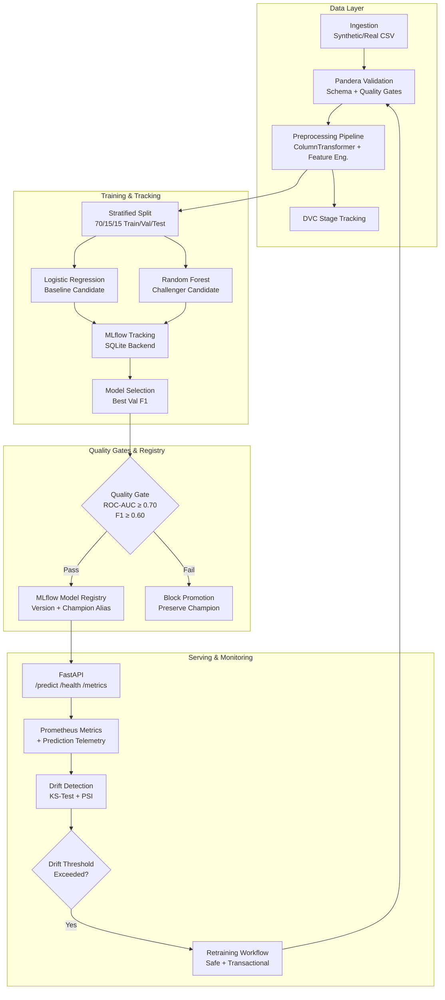

# Production MLOps Pipeline — Automated ML Lifecycle Platform

> **Enterprise-grade, end-to-end automated machine learning lifecycle** for Customer Churn Prediction. Built with Python 3.12, scikit-learn, MLflow, FastAPI, Pandera, Prometheus, and Docker.

---

## Table of Contents

- [Project Overview](#project-overview)
- [Architecture Diagram](#architecture-diagram)
- [Technology Stack](#technology-stack)
- [Repository Structure](#repository-structure)
- [Prerequisites](#prerequisites)
- [Quick Start (Windows PowerShell)](#quick-start-windows-powershell)
- [Environment Configuration](#environment-configuration)
- [Running the Pipeline](#running-the-pipeline)
- [Starting the API Server](#starting-the-api-server)
- [Sample API Requests](#sample-api-requests)
- [MLflow Experiment Tracking](#mlflow-experiment-tracking)
- [Drift Monitoring & Simulation](#drift-monitoring--simulation)
- [Automated Retraining](#automated-retraining)
- [Docker Compose Deployment](#docker-compose-deployment)
- [Testing & Linting](#testing--linting)
- [DVC Data Versioning](#dvc-data-versioning)
- [CI/CD with GitHub Actions](#cicd-with-github-actions)
- [Model Rollback Procedure](#model-rollback-procedure)
- [Troubleshooting](#troubleshooting)
- [Security Considerations](#security-considerations)
- [Known Limitations](#known-limitations)
- [Future Improvements](#future-improvements)

---

## Project Overview

**Business Problem**: Customer churn costs telecoms and SaaS companies 5–25% of annual revenue. This platform automates the entire ML lifecycle — from raw data ingestion to real-time churn probability prediction — with built-in data quality gates, experiment tracking, model registry promotion, drift alerting, and safe automated retraining.

**Key Capabilities**:
- Deterministic synthetic churn dataset (5,000 customers) with realistic feature distributions
- Automated Pandera schema validation with machine-readable quality reports
- Scikit-learn pipelines with leak-free preprocessing (fit on train only)
- Two candidate models: Logistic Regression (baseline) vs Random Forest (challenger)
- MLflow SQLite tracking with full experiment metadata, metrics, and artifacts
- Configurable quality gates: must pass ROC-AUC ≥ 0.70 and F1 ≥ 0.60
- MLflow Model Registry with `champion` alias promotion
- FastAPI inference server with Prometheus metrics and structured telemetry
- Statistical drift detection (KS test + PSI) against saved reference dataset
- Safe retraining with transactional quality gate safety (never overwrites champion on failure)
- GitHub Actions CI/CD (lint + test + smoke pipeline) and scheduled retraining workflow
- Complete Docker + Docker Compose deployment with Prometheus + Grafana

---

## Architecture Diagram



---

## Technology Stack

| Layer | Technology | Purpose |
|---|---|---|
| Language | Python 3.12 | Core runtime |
| Data Processing | pandas 2.3, NumPy 2.0 | Tabular data wrangling |
| ML Framework | scikit-learn 1.9 | Models + preprocessing pipelines |
| Experiment Tracking | MLflow 3.17 + SQLite | Full experiment lifecycle |
| Data Validation | Pandera 0.34 | Schema enforcement + quality gates |
| API Serving | FastAPI 0.143 + Uvicorn 0.54 | REST inference service |
| API Validation | Pydantic v2 2.14 | Request/response contracts |
| HTTP Testing | HTTPX 0.28 | API integration tests |
| Monitoring | prometheus-client 0.26 | Application metrics |
| Drift Detection | SciPy (KS test + Chi-Square + PSI) | Statistical drift |
| Code Quality | Ruff 0.17 | Fast lint + format |
| Testing | pytest 9.1 + pytest-cov 7.1 | Test suite |
| Visualization | matplotlib 3.11 + seaborn 0.13 | Confusion matrix plots |
| Containers | Docker + Docker Compose | Reproducible deployment |
| CI/CD | GitHub Actions | Automated pipeline |
| Data Versioning | DVC (documented) | Pipeline stage reproducibility |
| Config | YAML + python-dotenv | Environment-driven configuration |

---

## Repository Structure

```
mlops/
├── configs/
│   ├── config.yaml               # All pipeline, training, and monitoring settings
│   └── logging.yaml              # Structured logging configuration
├── data/
│   ├── raw/                      # Ingested CSV (customer_churn.csv + .meta.json)
│   ├── processed/                # Parquet splits (train/val/test)
│   └── reference/                # Baseline features for drift monitoring
├── reports/
│   ├── validation_report.json    # Pandera quality gate output
│   ├── evaluation_metrics.json   # Candidate model comparison
│   ├── confusion_matrix.png      # Validation set confusion matrix
│   ├── champion_metadata.json    # Registry promotion audit trail
│   └── drift_report.json         # Latest drift analysis
├── src/
│   └── mlops_platform/           # Installable Python package (pip install -e .)
│       ├── data/                 # ingestion.py, validation.py, preprocessing.py
│       ├── features/             # build_features.py (custom sklearn transformer)
│       ├── training/             # train.py, tune.py, evaluate.py
│       ├── registry/             # register_model.py (quality gates + MLflow registry)
│       ├── inference/            # predict.py, schemas.py (Pydantic v2)
│       ├── monitoring/           # drift.py, performance.py, retraining.py
│       └── utils/                # config.py, logging.py
├── api/
│   └── main.py                   # FastAPI application with Prometheus instrumentation
├── tests/                        # pytest unit + integration tests
│   ├── conftest.py               # Shared fixtures
│   ├── test_data_validation.py
│   ├── test_training.py
│   ├── test_predictions.py
│   ├── test_api.py
│   └── test_monitoring.py
├── scripts/
│   ├── bootstrap.py              # Environment initialization check
│   ├── run_pipeline.py           # End-to-end pipeline CLI
│   ├── generate_sample_data.py   # Synthetic + drifted data generator
│   └── simulate_traffic.py       # API traffic + drift simulation
├── monitoring/
│   └── prometheus.yml            # Prometheus scrape config
├── .github/
│   └── workflows/
│       ├── ci.yml                # CI: lint, test, smoke pipeline
│       └── retrain.yml           # Weekly automated retraining
├── Dockerfile                    # Non-root Python 3.12 container
├── docker-compose.yml            # API + Prometheus + Grafana stack
├── dvc.yaml                      # DVC pipeline stage definitions
├── params.yaml                   # DVC pipeline parameters
├── pyproject.toml                # PEP 517 package + Ruff configuration
├── requirements.txt              # Pinned Python dependencies
├── .env.example                  # Environment variable template
├── .gitignore
├── Makefile
└── README.md
```

---

## Prerequisites

| Requirement | Minimum | Notes |
|---|---|---|
| Python | 3.12 | `py -3.12 --version` to check |
| Git | 2.40+ | For version control |
| pip | 26+ | Auto-upgraded during install |
| Docker | 24+ (optional) | For container deployment |
| DVC | 3+ (optional) | For pipeline stage caching |
| ~1 GB disk space | — | For venv + MLflow artifacts |

---

## Quick Start (Windows PowerShell)

```powershell
# 1. Navigate to the mlops directory
cd "AI growth & agentic commerce\mlops"

# 2. Create an isolated Python 3.12 virtual environment
py -3.12 -m venv .venv

# 3. Activate the virtual environment
.\.venv\Scripts\Activate.ps1

# 4. Upgrade pip and install all dependencies + mlops_platform package
python -m pip install --upgrade pip
python -m pip install -e ".[dev]"

# 5. (Optional) Copy environment template
Copy-Item .env.example .env

# 6. Verify environment is healthy
python scripts/bootstrap.py
```

### Linux / macOS Setup

```bash
cd mlops
python3.12 -m venv .venv
source .venv/bin/activate
pip install --upgrade pip
pip install -e ".[dev]"
cp .env.example .env
python scripts/bootstrap.py
```

---

## Environment Configuration

Edit `.env` (copy from `.env.example`) to override defaults:

```env
# MLflow tracking — SQLite file-based, no cloud required
MLFLOW_TRACKING_URI=sqlite:///mlflow.db
MLFLOW_EXPERIMENT_NAME=customer_churn_prediction
MODEL_REGISTRY_NAME=customer_churn_classifier

# Quality gate thresholds
MIN_ROC_AUC_THRESHOLD=0.70
MIN_F1_THRESHOLD=0.60

# API settings
API_HOST=0.0.0.0
API_PORT=8000
LOG_LEVEL=INFO
```

All settings in `configs/config.yaml` can also be overridden by these environment variables.

---

## Running the Pipeline

The full automated ML pipeline executes all 5 stages end-to-end:

```powershell
# Full pipeline (generates data, trains, evaluates, promotes to registry)
python scripts/run_pipeline.py --config configs/config.yaml

# Force re-generation of raw dataset
python scripts/run_pipeline.py --force-ingest

# Enable hyperparameter tuning (GridSearchCV, slower)
python scripts/run_pipeline.py --tune

# Smaller sample for testing / CI smoke checks
python scripts/run_pipeline.py --samples 500
```

**Pipeline Stages**:
1. **Ingest**: Generate 5,000 deterministic synthetic customers (SHA-256 fingerprinted)
2. **Validate**: Pandera schema validation + null/range/duplicate checks → `reports/validation_report.json`
3. **Preprocess + Train**: Leak-free ColumnTransformer pipeline, two candidate models, MLflow tracking
4. **Evaluate**: Precision, Recall, F1, ROC-AUC, confusion matrix → `reports/evaluation_metrics.json`
5. **Promote**: Quality gates (ROC-AUC ≥ 0.70, F1 ≥ 0.60) → MLflow registry `champion` alias

**Expected Results** (verified run):
```
Winner: LOGISTIC_REGRESSION
  Val F1:  0.7104 | Val ROC-AUC:  0.8644
  Test F1: 0.7103 | Test ROC-AUC: 0.8639
```

---

## Starting the API Server

```powershell
# Start the FastAPI inference server
uvicorn api.main:app --host 0.0.0.0 --port 8000 --reload

# Or using the Makefile
make serve
```

Once running, access:
- **Swagger UI**: http://127.0.0.1:8000/docs
- **ReDoc**: http://127.0.0.1:8000/redoc
- **Health**: http://127.0.0.1:8000/health
- **Ready**: http://127.0.0.1:8000/ready
- **Model Info**: http://127.0.0.1:8000/model-info
- **Metrics**: http://127.0.0.1:8000/metrics (Prometheus format)

---

## Sample API Requests

### Health Check
```bash
curl http://127.0.0.1:8000/health
```
```json
{"status": "healthy", "timestamp_utc": "2026-10-26T17:21:20.123Z"}
```

### Single Churn Prediction
```bash
curl -X POST http://127.0.0.1:8000/predict \
  -H "Content-Type: application/json" \
  -d '{
    "customer_id": "CUST-10492",
    "tenure": 6,
    "monthly_charges": 89.95,
    "total_charges": 539.70,
    "contract_type": "Month-to-month",
    "payment_method": "Electronic check",
    "internet_service": "Fiber optic",
    "tech_support": "No",
    "online_security": "No",
    "paperless_billing": "Yes"
  }'
```
```json
{
  "success": true,
  "result": {
    "customer_id": "CUST-10492",
    "churn_prediction": 1,
    "churn_probability": 0.8342,
    "risk_tier": "High"
  },
  "model_name": "customer_churn_classifier",
  "model_version": "1",
  "request_id": "req-a1b2c3d4e5f6",
  "latency_ms": 4.21
}
```

### Batch Prediction
```bash
curl -X POST http://127.0.0.1:8000/predict/batch \
  -H "Content-Type: application/json" \
  -d '{"records": [
    {"customer_id": "CUST-001", "tenure": 48, "monthly_charges": 55.0,
     "total_charges": 2640.0, "contract_type": "Two year",
     "payment_method": "Credit card", "internet_service": "DSL",
     "tech_support": "Yes", "online_security": "Yes", "paperless_billing": "No"},
    {"customer_id": "CUST-002", "tenure": 3, "monthly_charges": 95.0,
     "total_charges": 285.0, "contract_type": "Month-to-month",
     "payment_method": "Electronic check", "internet_service": "Fiber optic",
     "tech_support": "No", "online_security": "No", "paperless_billing": "Yes"}
  ]}'
```

---

## MLflow Experiment Tracking

```powershell
# Launch the MLflow UI (tracked at sqlite:///mlflow.db)
mlflow ui --backend-store-uri sqlite:///mlflow.db --port 5000
```

Browse to **http://127.0.0.1:5000** to view:
- All training runs with parameters, metrics, and artifacts
- Model Registry with `customer_churn_classifier` versions
- Champion alias → version mapping
- Confusion matrix and evaluation report artifacts

---

## Drift Monitoring & Simulation

### Simulate Normal Inference Traffic
```powershell
python scripts/simulate_traffic.py --samples 200
```

### Simulate Drifted Traffic (Distribution Shift)
```powershell
# Injects severely drifted data into prediction telemetry log
python scripts/simulate_traffic.py --samples 200 --drift

# Detect drift by comparing against reference baseline
python -c "
from mlops_platform.monitoring.drift import analyze_prediction_logs
report = analyze_prediction_logs()
if report: print('Drift detected!' if report['dataset_drift_detected'] else 'No significant drift.')
"
```

**Drift Report** is saved to `reports/drift_report.json` with per-feature KS statistics, p-values, PSI scores, and distribution comparisons.

> **Note**: Drift detection tells you that *input data distribution has changed*. It does not prove the model is making incorrect predictions. Validate performance separately using ground-truth labels.

### Ground-Truth Performance Evaluation
```powershell
python -c "
import pandas as pd
from mlops_platform.monitoring.performance import evaluate_production_ground_truth

ground_truth = pd.DataFrame([
    {'customer_id': 'CUST-00001', 'churn': 1},
    {'customer_id': 'CUST-00002', 'churn': 0},
])
report = evaluate_production_ground_truth(ground_truth_df=ground_truth)
print(report)
"
```

---

## Automated Retraining

### Manual CLI Trigger
```powershell
python -m mlops_platform.monitoring.retraining
```

### Safety Guarantee
The retraining workflow provides **transactional safety**:
- If data validation fails → champion preserved, error returned
- If training crashes → champion preserved, error logged
- If quality gates fail → champion preserved, blocking reason reported
- Only if ALL gates pass → candidate promotes to new champion version

### GitHub Actions Scheduled Retraining
The `.github/workflows/retrain.yml` runs every Sunday at 02:00 UTC automatically, or manually via workflow dispatch.

---

## Docker Compose Deployment

> **Note**: Docker CLI is required. If Docker is not installed, all local Python commands above work without Docker.

```powershell
# Build the API image
docker build -t mlops-platform-api:latest .

# Start the full stack: API + Prometheus + Grafana
docker compose up -d

# Check logs
docker logs mlops-api

# Stop everything
docker compose down
```

**Service URLs** (Docker):
- API: http://localhost:8000/docs
- Prometheus: http://localhost:9090
- Grafana: http://localhost:3000 (admin/admin)

In Grafana, add a Prometheus datasource at `http://prometheus:9090` and build dashboards for:
- `http_requests_total` — total request count by endpoint
- `prediction_latency_seconds` — prediction latency histogram
- `prediction_churn_total` — churn classification counts
- `model_loaded_status` — liveness gauge

---

## Testing & Linting

```powershell
# Run all tests with verbose output
python -m pytest tests/ -v

# Run with coverage report
python -m pytest tests/ --cov=src/mlops_platform --cov-report=term

# Run only fast unit tests (no API tests)
python -m pytest tests/ -v -k "not test_api"

# Lint and format check
.\.venv\Scripts\ruff.exe check .
.\.venv\Scripts\ruff.exe format --check .
```

**Test Coverage**:

| Test File | Coverage Area |
|---|---|
| `test_data_validation.py` | Schema checks, null/range/type failures |
| `test_training.py` | Splitting, feature engineering, quality gates |
| `test_predictions.py` | Pydantic schema validation, boundary checks |
| `test_api.py` | FastAPI endpoints, health/ready/predict |
| `test_monitoring.py` | PSI, KS drift, ground-truth performance |

---

## DVC Data Versioning

```powershell
# Initialize DVC (first time only)
dvc init

# Run all pipeline stages (uses dvc.yaml)
dvc repro

# Check pipeline status
dvc status

# Track data files
dvc add data/raw/customer_churn.csv
git add data/raw/customer_churn.csv.dvc .gitignore
git commit -m "Track raw dataset with DVC"
```

DVC tracks Git-versioned **code** while keeping large data files and MLflow artifacts out of the Git repository. `dvc.yaml` defines reproducible pipeline stages tied to `params.yaml`.

---

## CI/CD with GitHub Actions

Two workflows are defined in `.github/workflows/`:

**`ci.yml`** — Runs on every push/PR:
1. Install Python 3.12 + dependencies
2. `ruff check .` — lint
3. `pytest tests/ -v` — test suite
4. `python scripts/run_pipeline.py --samples 500` — smoke training

**`retrain.yml`** — Weekly or manual dispatch:
1. Install dependencies
2. `python -m mlops_platform.monitoring.retraining` — full safe retraining

No external credentials are required for CI.

---

## Model Rollback Procedure

If a newly promoted model causes issues in production:

```powershell
# 1. View available model versions
python -c "
import mlflow
mlflow.set_tracking_uri('sqlite:///mlflow.db')
from mlflow.tracking import MlflowClient
client = MlflowClient()
for v in client.search_model_versions('customer_churn_classifier'):
    print(f'Version {v.version}: run_id={v.run_id}, aliases={v.aliases}')
"

# 2. Re-assign the champion alias to a previous version
python -c "
import mlflow
mlflow.set_tracking_uri('sqlite:///mlflow.db')
from mlflow.tracking import MlflowClient
client = MlflowClient()
client.set_registered_model_alias('customer_churn_classifier', 'champion', version='1')
print('Champion rolled back to version 1')
"

# 3. Restart the API server to reload the previous champion
```

---

## Troubleshooting

### `UnicodeEncodeError` on Windows
```powershell
$env:PYTHONIOENCODING="utf-8"
python scripts/run_pipeline.py
```

### `MLflow skops UntrustedTypesFoundException`
This is fixed automatically — the pipeline passes `skops_trusted_types` to `log_model`. If you see it, ensure you are running the latest code.

### `ModuleNotFoundError: No module named 'mlops_platform'`
```powershell
# Reinstall as editable package from mlops/ directory
python -m pip install -e ".[dev]"
```

### `pandera FutureWarning` about deprecated import
Set the environment variable:
```powershell
$env:DISABLE_PANDERA_IMPORT_WARNING="True"
```
The validation module already handles this automatically.

### `Model is not loaded` on API startup
The API needs a trained champion model. Run the pipeline first:
```powershell
python scripts/run_pipeline.py
```
Then start the API server.

### MLflow UI not starting
```powershell
# Ensure you use the correct backend URI
mlflow ui --backend-store-uri sqlite:///mlflow.db
```

### Port 8000 already in use
```powershell
uvicorn api.main:app --port 8001
```

---

## Security Considerations

- **No secrets in code**: API keys, passwords, and tokens belong in `.env` only (never committed)
- **Non-root container**: Docker image runs as `appuser` (uid 1000) — not root
- **No TLS disabled**: All network requests use proper TLS verification
- **Input validation**: All API inputs are validated by Pydantic v2 with strict type checking
- **Batch size limits**: `/predict/batch` is capped at 1,000 records per request
- **Model isolation**: Model reloading happens at startup only; prediction requests never trigger retraining
- **Rollback safety**: Automated retraining cannot overwrite champion unless all quality gates pass
- **Audit trail**: `reports/champion_metadata.json` logs every promotion with timestamp and run ID

---

## Known Limitations

| Limitation | Workaround / Future Fix |
|---|---|
| Docker CLI not available locally during dev | All components run natively with Python; Docker files are production-ready |
| MLflow warning: `artifact_path` deprecated in 3.17 | Use `name=` parameter in future MLflow upgrade |
| Pandera FutureWarning in 0.34 | Use `pandera.pandas` API — already applied in validation.py |
| No real-world dataset download (synthetic fallback) | Replace ingestion URL in `config.yaml` when real dataset is available |
| DVC remote storage not configured | Add `dvc remote add` for S3/GCS/Azure in team workflows |
| Grafana dashboards not pre-provisioned | Add JSON dashboard definitions to `monitoring/grafana/provisioning/` |

---

## Future Improvements

- **Gradient Boosting**: Add XGBoost or LightGBM as third candidate model
- **Real Dataset**: Integrate Kaggle Telco Churn dataset via `source_url` in config
- **Async API**: Switch to async FastAPI endpoints for higher throughput
- **Redis Caching**: Cache prediction results for repeated customer IDs
- **Feature Store**: Integrate Feast for centralized feature management
- **A/B Testing**: Shadow model deployment for parallel candidate evaluation
- **SHAP Explanations**: Add SHAP values to prediction responses for explainability
- **Cloud Deployment**: AWS SageMaker, GCP Vertex AI, or Azure ML endpoint configurations
- **Kubernetes**: Helm chart for K8s deployment with HPA autoscaling
- **Grafana Dashboards**: Pre-provisioned JSON dashboard for mlops-specific KPIs
- **Alertmanager**: Route Prometheus alerts to Slack/PagerDuty on drift thresholds

---

*Generated by the Production MLOps Pipeline v0.1.0 — Python 3.12 | MLflow 3.17 | FastAPI 0.143 | scikit-learn 1.9*
